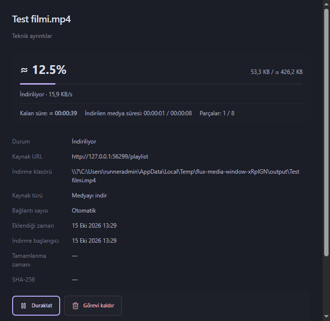
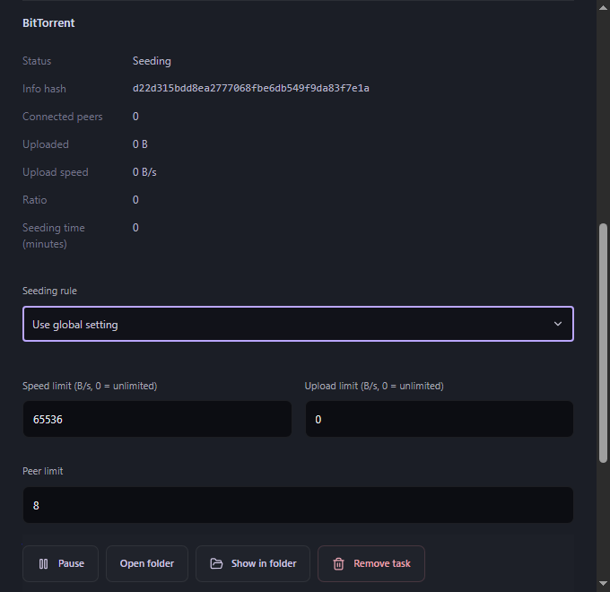
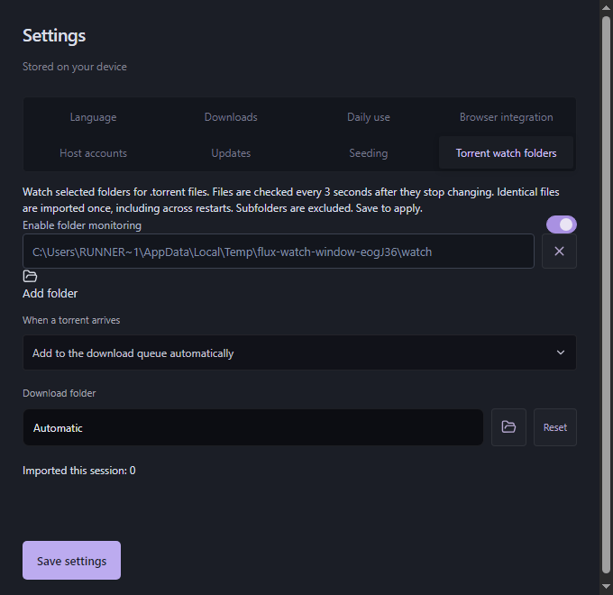
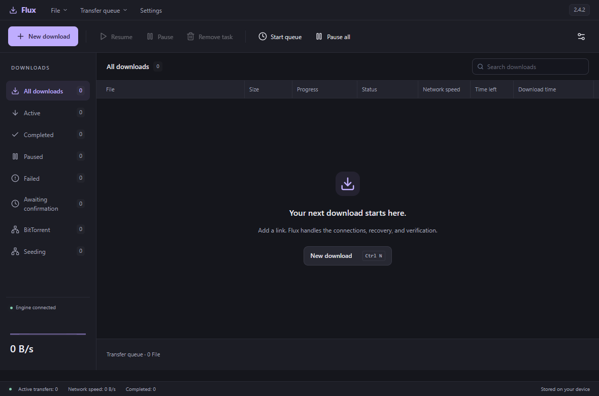
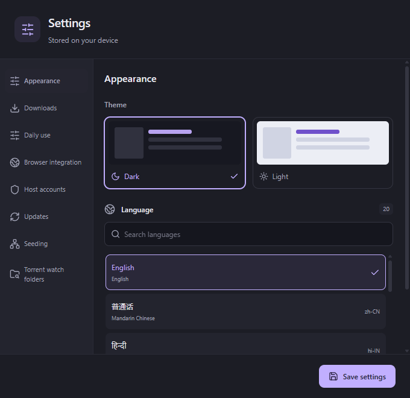
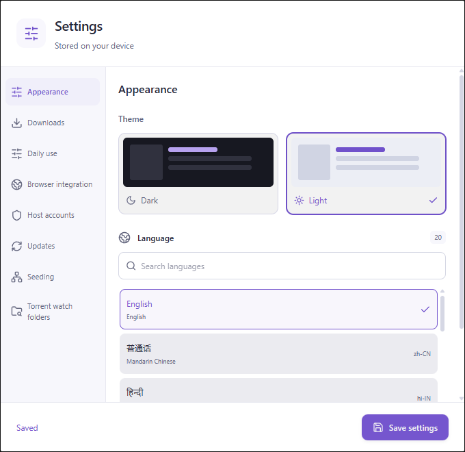

# Flux


<p align="center">
  <strong>One desktop queue for files, media and torrents.</strong><br>
  Open-source Windows and Linux download manager · Rust engine · Chromium and Firefox integration
</p>

<p align="center">
  <a href="https://github.com/Hactor00/Flux/releases/tag/v2.6.0"></a>
  <a href="https://github.com/Hactor00/Flux/actions/workflows/ci.yml"></a>
  
  <a href="LICENSE"></a>
  
</p>

<p align="center">
  <strong>English</strong> · <a href="README.tr.md">Türkçe</a><br>
  <a href="#download">Download</a> · <a href="#whats-new-in-260">What's new</a> · <a href="#features">Features</a> · <a href="#installation">Installation</a> · <a href="#validation">Validation</a> · <a href="#development">Development</a>
</p>

Flux combines segmented HTTP transfers, accessible video/audio capture, native BitTorrent, a persistent local history and separate desktop approval windows. It is built with Tauri 2, React 19, Tokio and SQLite WAL. The name refers to flow: files and media moving from your browser into your download queue.

> **Before downloading: connect your browser.** Install and enable the Flux extension, grant its requested site/native messaging permissions, and refresh open tabs. Launch Flux once: the installed and portable editions automatically register and repair the local browser bridge. If the extension still cannot connect, use **Settings → Browser integration → Repair browser bridge**. The desktop shows this guidance on first use; dismissing it keeps it hidden on later launches. Bridge registration does not install the extension.

## Download

**Current release: [Flux 2.6.0](https://github.com/Hactor00/Flux/releases/tag/v2.6.0), Windows x64 and Linux x86_64 (RPM).**

[Code signing policy](docs/code-signing-policy.md) · [Privacy policy](docs/browser-stores.md#privacy-disclosure-for-store-listings)

| Package | Purpose |
| --- | --- |
| **[Windows installer](https://github.com/Hactor00/Flux/releases/download/v2.6.0/Flux_2.6.0_x64-setup.exe)** | Recommended; per-user installation and automatic native-host registration |
| **[Linux RPM](https://github.com/Hactor00/Flux/releases/download/v2.6.0/Flux-2.6.0-linux-x86_64.rpm)** | Fedora x86_64; installs desktop, native host and torrent bridge; media dependencies are resolved by dnf |
| [Portable application](https://github.com/Hactor00/Flux/releases/download/v2.6.0/Flux-2.6.0-windows-x64.zip) | Desktop application, extensions and bundled media tools |
| [PortableApps layout](https://github.com/Hactor00/Flux/releases/download/v2.6.0/Flux-2.6.0-portableapps.zip) | Portable App/Data/Other layout; not certified by PortableApps.com |
| [Chromium extension](https://github.com/Hactor00/Flux/releases/download/v2.6.0/Flux-2.6.0-chrome.zip) | Chrome, Edge, Brave and compatible Chromium browsers |
| [Firefox 140+ extension](https://github.com/Hactor00/Flux/releases/download/v2.6.0/Flux-2.6.0-firefox.zip) | Modern Firefox |
| [Firefox 120–139 extension](https://github.com/Hactor00/Flux/releases/download/v2.6.0/Flux-2.6.0-firefox-120.zip) | Older supported Firefox versions |
| [Source archive](https://github.com/Hactor00/Flux/releases/download/v2.6.0/Flux-2.6.0-source.zip) | Source, build scripts, tests and release documentation |
| [SHA-256 checksums](https://github.com/Hactor00/Flux/releases/download/v2.6.0/SHA256SUMS.txt) | Verify downloaded package identity |

Application update packages carry a signature checked against Flux's embedded verification key. The Windows installer and executables **do not have an Authenticode publisher certificate**; Windows may display a publisher or SmartScreen warning. Firefox ZIPs are unsigned and require Mozilla signing for permanent installation. See [release and signing](docs/release.md) and [browser distribution](docs/browser-stores.md).

Previous [2.3.0](https://github.com/Hactor00/Flux/releases/tag/v2.3.0), [2.2.0](https://github.com/Hactor00/Flux/releases/tag/v2.2.0), [2.0.0](https://github.com/Hactor00/Flux/releases/tag/v2.0.0) and [1.7.0](https://github.com/Hactor00/Flux/releases/tag/v1.7.0) packages remain available.

## What's new in 2.6.0

- **Both Firefox distributions connect:** the Mozilla store identity and existing GitHub identity use the same desktop bridge. Open Flux once after updating.
- **Information before download:** see sizes reported by the source and select files inside a torrent before queueing. HTTP torrent links can also save only the .torrent metadata file.
- **Video preview:** task details can decode a frame from downloaded data. Preview availability depends on the format and sufficient readable data.
- **Portable data stays together:** settings/history live in Data/Flux and default downloads in Data/Downloads. Stored paths inside the folder are adjusted after a move. A PortableApps layout ZIP is also provided.
- **Reliable upgrades:** installed Windows copies use signed installers; portable copies open downloads to preserve their Data folder. Extensions check releases on startup and periodically.
- **Complete packages:** Windows, Linux, Chromium and Firefox use 2.6.0. Publisher-only store ZIPs are kept separate from public GitHub downloads.

## 2.4 series highlights

- **More reliable HLS audio/video assembly:** manifest-aware segment detection handles image-named or extensionless media segments served through the local relay, avoiding FFmpeg rejecting a valid stream based only on a segment URL suffix.
- **CSP-friendly media discovery:** the browser extension observes bounded HLS/DASH responses without replacing the page's `fetch` function, preserving site behavior on stricter Content Security Policies.
- **Filename prefixes and folders:** add a prefix to file or media downloads, use `/` to organize them into relative subfolders, preview the final path and reuse any of the ten recent prefixes.
- **Safer paths:** prefix paths are validated before queueing; absolute paths and traversal outside the selected download directory are rejected.
- **Existing capabilities retained:** segmented HTTP and resume, media discovery and processing, native torrents and watched folders, Linux RPM, browser handoff, local history and twenty languages.

Read the [2.6.0 release notes](docs/releases/v2.6.0.md), [build and platform guide](docs/release-2.4.md) and [validation](docs/validation-2.6.0.md).

## Features

| Area | Included capabilities |
| --- | --- |
| HTTP downloads | Automatic/manual 1–32 connections, checked ranges, dynamic splitting, bounded retries, stalled-connection replacement, HTTP/3 with TCP fallback |
| Disk and integrity | Sparse staging on the destination volume, disjoint positional writes, checkpoint/final SHA-256 and exclusive publication without chunk concatenation |
| Queue and history | Priorities, schedules, shared/per-task limits, pause/resume, SQLite history, creation/start/completion times, up to 500 URLs per batch and wildcard expansion |
| Naming and folders | Reusable filename prefixes, ten-entry recent-prefix history, safe relative subfolders and final-path preview |
| Video and audio | HLS, DASH, ordered TS, MP4/MKV video, MP3 audio and lossless MKA extraction |
| Media processing | Selected video/audio muxing, subtitle embedding/SRT export, chapters and two-pass audio normalization |
| Media discovery | DOM/network observation, video/audio and iframe players, accessible blob/MediaSource resources, titles, resolution, fps, audio tracks and subtitles |
| Collections | Provider-supported playlists/channel feeds and captured page-link batches |
| BitTorrent | v1, BEP 52 v2/hybrid, magnets, local/HTTP `.torrent` import, DHT, trackers, PEX, LSD, peers and file selection |
| Torrent sharing | Piece verification, selected-file SHA-256, upload/download budgets, peer limits and global/per-task seeding rules |
| Source recovery | Origin-scoped browser session refresh, compatible expired-source renewal and bounded native HLS/DASH manifest fallback |
| Debrid accounts | Encrypted Real-Debrid, AllDebrid/Premiumize API keys, supported-host resolution and CDN source renewal |
| Desktop | Separate approval, progress, Settings/countdown windows; virtualized table, search, sorting, multi-selection and Windows file drag-out |
| Torrent automation | Up to 16 watched folders, stable-file detection, confirmation/automatic queueing and durable duplicate suppression |
| Platforms | Windows x64 installer/portable and Linux x86_64 RPM |
| Daily use | Optional category folders, clipboard monitoring, silent queueing, Windows startup and cancellable completion actions |
| Languages and updates | 20 languages, 241 desktop keys, searchable selector, Arabic/Urdu RTL and signed updates with user approval |

### HTTP and disk

Workers write bounded network buffers to non-overlapping offsets in task-owned staging. Aligned Windows transfers use unbuffered positional writes; existing unaligned checkpoints retain buffered writes. Linux/macOS allocation adapters are included in source. Completion uses one integrity read and exclusive publication without a chunk-merging pass. This is positional I/O, not a kernel-level zero-copy networking claim.

Disconnects, truncated responses, rate limits and retryable server errors have bounded recovery. Global/per-task token buckets control bandwidth. Resume checks local checkpoints and source identity; validator-free sources are compared to saved prefixes. Changed validators, sizes or prefixes are handled explicitly instead of mixing different objects.

### Media

The extension observes elements, frames, requests and bounded fetch/XHR manifest snapshots. Bundled yt-dlp resolves metadata asynchronously; FFmpeg/FFprobe inspect and assemble selected streams. Resolution choices are deduplicated, and selected audio belongs to the same provider item.

Finite media without an exact byte total can show size, percentage and ETA estimates marked **≈**, using duration/segment metadata. Live streams or insufficient metadata remain indeterminate. Blob URLs need accessible underlying resources; DRM, CAPTCHA and login challenges are not bypassed.

### Torrents

Flux embeds **librqbit 9.0.1** for v1 and **libtorrent 2.1.2** for v2/hybrid without a separate daemon. HTTP and torrents share bandwidth budgets. Seeding supports ratio, duration, either condition, unlimited sharing or disabled sharing. The default ratio is **1.0**; global/per-task choices persist across restarts. Per-torrent speed limits accept unlimited (`0`) or at least **16 KiB/s**.

<details>
<summary><strong>See the 2.3 desktop</strong></summary>

Screenshots from isolated Windows regression tests with local fixture media.

| Media progress and estimated remaining time | Torrent sharing controls |
| --- | --- |
|  |  |

**Watched torrent folders**



</details>

## Interface



| Dark settings | Light settings |
| --- | --- |
|  |  |

Screenshots of the actual 2.4.2 interface from an isolated Windows profile.

## Installation

### Windows desktop

1. Run `Flux_2.6.0_x64-setup.exe`; installation is per-user.
2. FFmpeg, FFprobe, yt-dlp, Node and torrent runtimes are bundled. Missing WebView2 is installed using Microsoft's bootstrapper, which needs internet access.
3. Native Messaging is registered for **Chrome, Edge, Brave, Chromium and Firefox**. Host registration does not install a browser extension.
4. Launch Flux once after installing the extension. Both installed and portable editions register/repair the bridge automatically at startup. **Settings → Browser integration → Repair browser bridge** remains available if permissions or files prevent automatic registration.

Installed data lives under `Flux` in the current user’s local application-data directory; downloads default to `Downloads/Flux`. Upgrades retain history/preferences. New portable packages instead use `Data/Flux` and `Data/Downloads` inside their folder. To migrate a 2.5.0 portable profile, close Flux and copy the old local-app-data `Flux` folder to `Data/Flux` before first launch; keep a backup. Windows-protected browser credentials may need refreshing on another computer.

Upgrade from older packages by running the current installer manually. Existing Windows installations can use the signed update prompt.

### Linux RPM

Install or upgrade on Fedora x86_64:

```bash
sudo dnf install ./Flux-2.6.0-linux-x86_64.rpm
flux-desktop
```

The package includes the CLI, native host, pinned yt-dlp and the native torrent bridge. `dnf` resolves WebKitGTK 4.1, GTK, AppIndicator, OpenSSL 3, FFmpeg, Python 3.10+ and Node 20+. Launch Flux once as your normal user to register the browser bridge. Install the same Chromium/Firefox extension ZIPs listed above. Sandboxed Flatpak/Snap browsers may need host integration outside the package's scope.

Linux preferences/history use `~/.local/share/Flux` by default, following XDG data settings. Watch folders run while Flux is open, including in the tray. RPM updates are installed with `dnf`; in-app update controls open the current GitHub release. Native file drag-out is Windows-only. Systemd power actions require an authorized desktop session; they are disabled by default.

### Torrent watch folders

Open **Settings → Torrent watch folders**, add one or more folders, enable monitoring, choose confirmation or automatic queueing, then **Save**. An optional destination overrides the normal download directory. Only directly contained `.torrent` files are scanned; source files are never moved or deleted. Monitoring resumes on restart and detects files added while Flux was closed. Use manual torrent import to deliberately add an identical file again. Limits: 16 folders, 4096 torrent entries, 8 MiB per metadata file and at most 64 candidates/16 MiB per scan.

### Chromium browsers

1. Extract the Chromium extension ZIP or use the installed `extension` directory.
2. Open `chrome://extensions` or `edge://extensions`, enable **Developer mode**, select **Load unpacked**, and choose that directory.
3. The unpacked ID is `iheejmamcoeigoallciifjminjnnnlbj`. Enable interception in extension settings and check the desktop connection.
4. After updating, reload/update the extension and refresh media tabs. Extensions update separately from the desktop installer.

### Firefox

Use the matching **140+** or **120–139** package. Open `about:debugging#/runtime/this-firefox`, select **Load Temporary Add-on**, and choose the extracted `manifest.json`. Enable local Flux data transfer in extension settings and grant site access when requested.

Temporary add-ons disappear after restarting Firefox. Standard Firefox requires a Mozilla-signed XPI for permanent installation. Store publication is separate; these ZIPs do not imply a public store listing. See [Firefox setup](extension-firefox/README.md).

**Another download manager installed?** Disable its automatic capture in the browser Flux will handle. A system-wide hook can capture requests before Flux's extension sees them. Flux does not alter another application's settings.

## Daily use

- **Files:** click a download link or add a URL. Flux approval offers name, destination, connections, speed limit, immediate start or queueing. If Flux is unavailable before ownership changes, the browser retains the transfer. Later errors after durable handoff stay in Flux.
- **Media:** choose quality/output on the floating button and send to Flux. Drag the grip anywhere in the tab's visible viewport; arrow keys move it and Home restores its default corner. Positions persist per domain. Outside clicks close the panel; the cross hides the HUD for the page session. The extension popup controls media-button visibility.
- **History:** search/sort downloads, inspect creation/start/completion times, open/show completed files or drag them into Windows applications.
- **Preferences:** category routing and clipboard monitoring are opt-in. Explicit destinations override routing. Silent clipboard mode adds to the durable queue without a window.
- **Queue completion:** exit, sleep, hibernate or shut down after a cancellable **30-second** countdown. New work/changed state cancels it; pending, paused or unsuccessful tasks prevent completion. Disabled by default.
- **Windows updates:** the main desktop checks GitHub about three seconds after opening; Settings has a manual check. A newer version displays notes and asks for approval before download/install. Flux verifies signatures, checkpoints active tasks and restarts after installation. Startup check errors stay silent.

## Languages

English, Mandarin Chinese, Hindi, Spanish, Standard Arabic, French, Bengali, Portuguese, Russian, Urdu, Indonesian, German, Japanese, Nigerian Pidgin, Marathi, Telugu, Turkish, Tamil, Yue Chinese and Vietnamese.

New desktop profiles use the OS locale; extensions use the browser UI locale. Unsupported locales use English. Manual selections persist; Arabic/Urdu use RTL layout.

## Privacy and security

No analytics endpoint or remote Flux account. The extension sends selected URLs, titles, bounded manifests and required origin-scoped session headers to the **local** application. Firefox native transfer requires consent. Credentials are encrypted before durable storage; public task responses omit them. Consent can be withdrawn in settings.

Downloads contact their source; torrents contact peers/trackers/DHT. Enabled Debrid accounts contact their APIs; update checks contact GitHub. Native Messaging uses caller checks, bounded frames and an authenticated user-scoped loopback broker. See [Security](SECURITY.md), [IPC](docs/protocol.md) and [privacy disclosure](docs/browser-stores.md#privacy-disclosure-for-store-listings).

## Validation

The [2.4 validation report](docs/validation-2.4.md) records the release's exact automated test counts and package identities. Checks include Rust, extension and frontend suites, strict TypeScript, production builds, Rust formatting and Clippy. Watch-folder and filename-prefix tests cover incomplete or invalid input, path safety, approval/automatic modes, duplicate suppression, removal and persistence.

Linux is built in GitHub Actions and checked separately from the Windows package. The RPM validation installs the package in a Fedora environment and exercises dependency loading, HTTP payload hashes, desktop startup, browser manifests, Native Messaging, watched-torrent import, duplicate prevention and SQLite integrity. See [2.4 validation and its limits](docs/validation-2.4.md) for the verified result and workflow links.

Previous release evidence is retained as historical evidence. It does not replace a 2.4 package check. These tests are defined regressions, not an every-site guarantee, a competitor benchmark or certification for every RPM distribution. macOS packaging, paid Debrid entitlements, real computer power transitions and Linux browser sandbox integration are outside the release checks.

## Development

Use **Rust 1.99.0**, **Node 24.18.0**, [Tauri prerequisites](https://v2.tauri.app/start/prerequisites/) and native torrent dependencies from the [build guide](docs/release-2.1.md).

```powershell
git clone https://github.com/Hactor00/Flux.git
cd Flux
npm ci
./scripts/build-torrent-runtime.ps1
npm run tauri dev
```

`npm run dev` is a browser preview; native downloads need Tauri. Generated Firefox assets come from shared `extension/` sources. Production builds exclude the test harness.

```powershell
npm test
cargo fmt --all -- --check
cargo test --locked --workspace --all-features
cargo clippy --locked --workspace --all-targets --all-features -- -D warnings
```

For required media tests, configure FFmpeg/FFprobe and the pinned fixture encoder as described in [Contributing](CONTRIBUTING.md). The full encoder is test-only, never shipped. Source export follows Git ignore rules and excludes toolchains, caches, user data and private signing keys.

## Documentation and contribution

| Document | Contents |
| --- | --- |
| [2.4 release notes](docs/releases/v2.6.0.md) | English/Turkish release overview |
| [2.4 build and platform guide](docs/release-2.4.md) | Release packaging and platform differences |
| [Architecture](docs/architecture.md) · [IPC](docs/protocol.md) | Engine ownership, persistence and browser protocol |
| [Validation](docs/validation.md) | Current and historical evidence |
| [Building/signing](docs/release.md) | Runtime preparation, packaging and signatures |
| [Browser distribution](docs/browser-stores.md) | Registration, store packages and privacy |
| [Contributing](CONTRIBUTING.md) · [Security](SECURITY.md) | Development, bugs and private disclosure |

Use [GitHub Issues](https://github.com/Hactor00/Flux/issues) for reproducible bugs and feature requests. Include versions and reproduction steps; remove private URLs, cookies and authorization headers.

## License

Flux's owned code is [MIT](LICENSE). FFmpeg/LAME use LGPL, libxml2 uses MIT, yt-dlp uses Unlicense; Node, libtorrent, OpenSSL and other dependencies retain their notices. Distributions include dependency inventories, required notices and media sources. SHA-256 identifies files; it does not replace Authenticode or malware scanning.

### Code signing policy

The acknowledgment for approved SignPath-signed releases is: **“This project uses SignPath Foundation for code signing.”**

Flux is preparing free code signing through [SignPath.io](https://signpath.io), with a certificate provided by [SignPath Foundation](https://signpath.org). Foundation approval and production signing configuration are pending; current 2.6.0 Windows packages do not carry an Authenticode publisher certificate. The existing updater signature is separate.

See the [code signing policy](docs/code-signing-policy.md) for signing scope, maintainer/approver roles and release verification. **Privacy Policy URL:** [Flux privacy disclosure](https://github.com/Hactor00/Flux/blob/main/docs/browser-stores.md#privacy-disclosure-for-store-listings).
