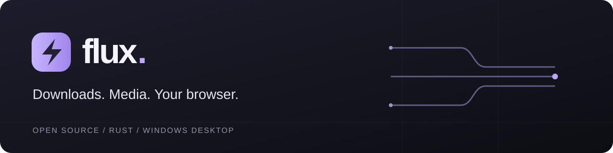
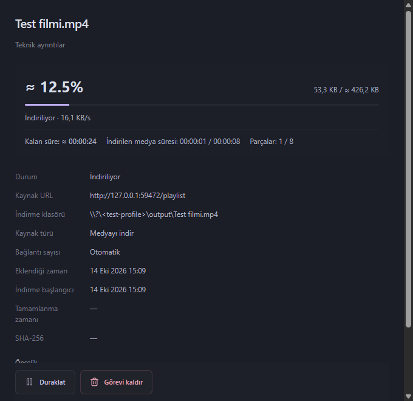
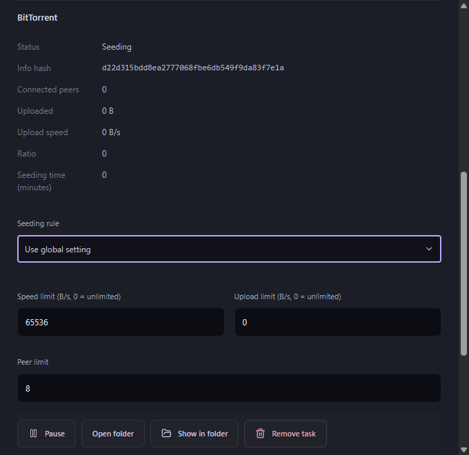

# Flux



<p align="center">
  <strong>Dosyalar, medya ve torrentler için tek masaüstü kuyruğu.</strong><br>
  Açık kaynaklı Windows indirme yöneticisi · Rust motoru · Chromium ve Firefox entegrasyonu
</p>

<p align="center">
  <a href="https://github.com/Hactor00/Flux/releases/tag/v2.2.0"></a>
  <a href="https://github.com/Hactor00/Flux/actions/workflows/ci.yml"></a>
  
  <a href="LICENSE"></a>
  
</p>

<p align="center">
  <a href="README.md">English</a> · <strong>Türkçe</strong><br>
  <a href="#i%CC%87ndir">İndir</a> · <a href="#22deki-yenilikler">Yenilikler</a> · <a href="#özellikler">Özellikler</a> · <a href="#kurulum">Kurulum</a> · <a href="#doğrulama">Doğrulama</a> · <a href="#geliştirme">Geliştirme</a>
</p>

Flux; çok bağlantılı HTTP indirmelerini, erişilebilir video/ses yakalamayı, yerleşik BitTorrent motorlarını, kalıcı yerel geçmişi ve ayrı masaüstü onay pencerelerini birleştirir. Tauri 2, React 19, Tokio ve SQLite WAL üzerine kuruludur. Adı “akış” fikrinden gelir: tarayıcıdaki dosya ve medyanın indirme kuyruğuna akması.

> **İndirmeden önce: tarayıcını bağla.** Flux eklentisini kurup etkinleştir, istenen site/yerel mesajlaşma izinlerini ver ve açık sekmeleri yenile. Flux'u bir kez aç: kurulu ve taşınabilir sürüm, yerel tarayıcı köprüsünü otomatik kaydeder ve onarır. Eklenti yine bağlanamıyorsa **Ayarlar → Tarayıcı bütünleşmesi → Tarayıcı köprüsünü onar** yolunu kullan. Program ilk kullanımda bu bilgiyi gösterir; kapatınca sonraki açılışlarda tekrar göstermez. Köprü kaydı eklentiyi kurmaz.

## İndir

**Güncel sürüm: [Flux 2.2.0](https://github.com/Hactor00/Flux/releases/tag/v2.2.0), Windows x64.**

[Kod imzalama politikası (Code signing policy)](docs/code-signing-policy.md) · [Gizlilik politikası](docs/browser-stores.md#privacy-disclosure-for-store-listings)

| Paket | Kullanımı |
| --- | --- |
| **[Windows kurulumu](https://github.com/Hactor00/Flux/releases/download/v2.2.0/Flux_2.2.0_x64-setup.exe)** | Önerilen; kullanıcı hesabına kurulum ve otomatik yerel köprü kaydı |
| [Taşınabilir uygulama](https://github.com/Hactor00/Flux/releases/download/v2.2.0/Flux-2.2.0-windows-x64.zip) | Masaüstü uygulaması, eklentiler ve medya araçları |
| [Chromium eklentisi](https://github.com/Hactor00/Flux/releases/download/v2.2.0/Flux-2.2.0-chrome.zip) | Chrome, Edge, Brave ve uyumlu Chromium tarayıcıları |
| [Firefox 140+ eklentisi](https://github.com/Hactor00/Flux/releases/download/v2.2.0/Flux-2.2.0-firefox.zip) | Güncel Firefox |
| [Firefox 120–139 eklentisi](https://github.com/Hactor00/Flux/releases/download/v2.2.0/Flux-2.2.0-firefox-120.zip) | Desteklenen eski Firefox sürümleri |
| [Kaynak kod arşivi](https://github.com/Hactor00/Flux/releases/download/v2.2.0/Flux-2.2.0-source.zip) | Kaynaklar, derleme betikleri, testler ve yayın belgeleri |
| [SHA-256 özetleri](https://github.com/Hactor00/Flux/releases/download/v2.2.0/SHA256SUMS.txt) | İndirilen paketlerin dosya kimliğini doğrulama |

Güncelleme paketleri, Flux içindeki doğrulama anahtarıyla kontrol edilen imzayı taşır. Windows kurulum dosyası ve çalıştırılabilir dosyalarda **Authenticode yayıncı sertifikası yoktur**; Windows yayıncı veya SmartScreen uyarısı gösterebilir. Firefox ZIP'leri imzasızdır, kalıcı kurulum Mozilla imzası gerektirir. Ayrıntılar: [yayın ve imzalama](docs/release.md), [tarayıcı dağıtımı](docs/browser-stores.md).

Önceki [2.0.0](https://github.com/Hactor00/Flux/releases/tag/v2.0.0) ve [1.7.0](https://github.com/Hactor00/Flux/releases/tag/v1.7.0) paketleri erişilebilir durumdadır.

## 2.2'deki yenilikler

- **Otomatik tarayıcı kurulumu:** açılış, Chrome, Edge, Brave, Chromium ve Firefox için eksik/eski yerel köprü kaydını ayarlara gitmeden onarır. İlk kullanım bildirimi eklenti izinlerini hatırlatır; kapatılınca tekrar görünmez. Ayarlarda kayıt durumu ve onarım düğmesi bulunur.

- **Medya aktarımı düzeltmesi (14 Ekim):** Chrome ve Firefox masaüstü onayını bekler, aktarım hatalarını gösterir. Seçilen kalite ve çıktı türü onay penceresinde tekrar inceleme gerektirmeden hazırdır; isteğe bağlı inceleme yakalanan kaynağı, dosya adını ve çıktı biçimini korur. Eski yerel köprüleri bozan boş yeni alanlar gönderilmez. Masaüstü ve eklenti paketlerini birlikte yenile; sürüm 2.2.0 kaldığı için kurulu 2.2 üzerinde paket yenilemesi elle yapılır.
- **Dosya seçimi açılmadan devralma:** Chromium dosya adı aşamasını serbest bırakmadan bekletilen aktarımı iptal eder; Firefox dosya gezinmesini yanıt başlıklarında yakalar. Flux kendi onay penceresini ön planda açar.
- **ETag olmadan doğrulanmış sürdürme:** Range artık güçlü ETag şartına bağlı değildir. Kayıtlı başlangıç bölümleri SHA-256 ile karşılaştırılmadan devam edilmez; değişmiş kaynaklardan karışık dosya üretilmez.
- **Range olmadan ilerlemeyi koruma:** yeniden gelen başlangıç bölümü doğrulanıp atılır, yeni baytlar sona eklenir. Disk verisi ve ilerleme korunur; tekrar okuma yine ağ trafiği tüketir.
- **Medya düğmesi anahtarı:** eklentinin küçük penceresinden düğmeleri aç/kapat; açık çerçevelerde hemen uygulanır. Yeniden açmak gizlenmiş HUD'u da geri getirir.
- **Otomatik dil:** yeni masaüstü profilleri sistemi, eklenti tarayıcı arayüz dilini izler. Desteklenmeyen dilde İngilizce kullanılır; elle yapılan seçim korunur.
- **Doğrudan Ayarlar:** ayrı Ayarlar penceresine üst menü veya araç çubuğundan ulaş.

[2.2 yayın notları](docs/releases/v2.2.0.md), [teknik değişiklikler](docs/release-2.2.tr.md) ve [doğrulama](docs/validation-2.2.md) ayrıntıları içerir.

## Özellikler

| Alan | İşlevler |
| --- | --- |
| HTTP indirmeleri | Otomatik/elle 1–32 bağlantı, doğrulanmış Range, dinamik bölme, sınırlı yeniden deneme, takılan bağlantıyı yenileme, HTTP/3 ve TCP'ye dönüş |
| Disk ve bütünlük | Hedef diskte seyrek geçici dosya, ayrı ofsetlere yazma, checkpoint/son SHA-256 ve parça birleştirmeden güvenli yayımlama |
| Kuyruk ve geçmiş | Öncelik, zamanlama, toplam/görev hız sınırı, duraklatma/sürdürme, SQLite geçmişi, eklenme/başlangıç/tamamlanma zamanı, 500 URL'lik gruplar ve joker genişletme |
| Video ve ses | HLS, DASH, sıralı TS, MP4/MKV video, MP3 ses ve kayıpsız MKA çıkarma |
| Medya işleme | Seçilen video/ses birleştirme, altyazı gömme/SRT çıkarma, bölümler ve iki geçişli ses normalizasyonu |
| Medya keşfi | DOM/ağ gözlemi, video/ses ve iframe oynatıcıları, erişilebilir blob/MediaSource, başlık, çözünürlük, fps, ses akışları ve altyazılar |
| Koleksiyonlar | Sağlayıcının desteklediği oynatma listeleri/kanal akışları ve sayfa bağlantı grupları |
| BitTorrent | v1, BEP 52 v2/hibrit, magnet, yerel/HTTP `.torrent`, DHT, tracker, PEX, LSD, eşler ve dosya seçimi |
| Torrent paylaşımı | Parça doğrulama, seçili dosyaların SHA-256 kontrolü, indirme/yükleme bütçesi, eş sınırı ve genel/görev paylaşım kuralları |
| Kaynak kurtarma | Kaynağa bağlı tarayıcı oturumu yenileme, uyumlu süresi dolmuş bağlantı kurtarma ve sınırlı yerel HLS/DASH manifest çözümleme |
| Debrid hesapları | Şifreli Real-Debrid, AllDebrid/Premiumize API anahtarları, desteklenen sunucuları çözme ve CDN kaynağını yenileme |
| Masaüstü | Ayrı onay, ilerleme, Ayarlar/geri sayım; sanallaştırılmış tablo, arama, sıralama, çoklu seçim ve Windows'a dosya sürükleme |
| Günlük kullanım | İsteğe bağlı kategori klasörü, pano izleme, sessiz kuyruk, Windows başlangıcı ve iptal edilebilir tamamlanma eylemleri |
| Dil ve güncelleme | 20 dil, 228 masaüstü anahtarı, aranabilir seçici, Arapça/Urduca RTL ve kullanıcı onaylı imzalı güncelleme |

### HTTP ve disk

İşçiler, sınırlı ağ tamponlarını göreve ait geçici dosyanın çakışmayan ofsetlerine yazar. Hizalı Windows indirmelerinde tamponsuz konumsal yazma, hizasız eski checkpoint'lerde tamponlu yazma kullanılır. Linux/macOS alan ayırma uyarlamaları kaynakta vardır. Tamamlama tek bütünlük okuması ve güvenli yayımlamayla yapılır; parça birleştirme aşaması gerekmez. Bu yapı konumsal disk yazmadır; çekirdek seviyesinde sıfır kopyalı ağ aktarımı iddiası taşımaz.

Kopmalar, kesilmiş yanıtlar, hız kısıtlamaları ve geçici sunucu hataları sınırlı yeniden denemeyle ele alınır. Genel/görev token bucket hız sınırları uygulanır. Sürdürmede checkpoint ve kaynak kimliği kontrol edilir; doğrulayıcısı olmayan kaynaklar kayıtlı başlangıç bölümleriyle karşılaştırılır. Değişmiş ETag, boyut veya içerik açıkça ele alınır.

### Medya

Eklenti öğeleri, çerçeveleri, istekleri ve sınırlı fetch/XHR manifest kayıtlarını gözlemler. Paket içindeki yt-dlp bilgileri asenkron çözer; FFmpeg/FFprobe seçilen akışları inceler ve birleştirir. Çözünürlükler tekilleştirilir, seçilen ses aynı sağlayıcı öğesine aittir.

Boyutu bilinmeyen sonlu medyada süre/parça bilgisiyle **≈** işaretli boyut, yüzde ve kalan süre tahmini gösterilebilir. Canlı yayın veya yetersiz veri belirsiz kalır. Blob adresleri erişilebilir alt kaynak gerektirir; DRM, CAPTCHA ve giriş doğrulamaları aşılmaz.

### Torrentler

Flux, v1 için **librqbit 9.0.1**, v2/hibrit için **libtorrent 2.1.2** motorunu uygulamaya gömülü çalıştırır; ayrı daemon gerekmez. HTTP ve torrentler hız bütçesini paylaşır. Paylaşım oran, süre, ikisinden biri, sınırsız veya kapalı olabilir. Varsayılan oran **1,0**'dır; genel/görev seçimleri yeniden başlatmada korunur. Torrent hız sınırı sınırsız (`0`) veya en az **16 KiB/sn** olabilir.

<details>
<summary><strong>2.2 masaüstü görünümünü incele</strong></summary>

Görüntüler, yerel test medyasıyla yürütülen izole Windows regresyon testlerinden alınmıştır.

| Medya ilerlemesi ve yaklaşık kalan süre | Torrent paylaşım ayarları |
| --- | --- |
|  |  |

</details>

## Kurulum

### Masaüstü

1. `Flux_2.2.0_x64-setup.exe` dosyasını çalıştır; kurulum kullanıcı hesabına yapılır.
2. FFmpeg, FFprobe, yt-dlp, Node ve torrent çalışma zamanları pakettedir. WebView2 yoksa Microsoft kurulum aracı internet ister.
3. **Chrome, Edge, Brave, Chromium ve Firefox** için Native Messaging kaydedilir. Köprü kaydı tarayıcı eklentisini kurmaz.
4. Eklentiyi kurduktan sonra Flux'u bir kez aç. Kurulu ve taşınabilir sürüm, köprüyü açılışta otomatik kaydeder/onarır. İzinler veya eksik dosyalar kaydı engellerse **Ayarlar → Tarayıcı bütünleşmesi → Tarayıcı köprüsünü onar** kullanılabilir.

Veriler kullanıcının yerel uygulama verilerindeki `Flux` klasöründe, varsayılan indirmeler `Downloads/Flux` içindedir. Güncelleme geçmişi/tercihleri korur. Kurulumları değiştirmeden önce önemli verilerini yedekle.

Yayımlanan 1.7/2.0 paketlerinden geçişte 2.2 kurulumunu elle çalıştır. Bu eski paketler yeni güncelleyiciyi ancak 2.2 kurulduğunda kazanır.

### Chromium tarayıcıları

1. Chromium ZIP'ini çıkar veya kurulum içindeki `extension` klasörünü kullan.
2. `chrome://extensions` ya da `edge://extensions` sayfasında **Geliştirici modu**nu aç; **Paketlenmemiş öğe yükle** ile klasörü seç.
3. Kimlik `iheejmamcoeigoallciifjminjnnnlbj` olur. Eklenti ayarlarında indirme yakalamayı aç ve masaüstü bağlantısını kontrol et.
4. Güncellemeden sonra eklentiyi de güncelle/yeniden yükle ve medya sekmelerini yenile. Eklentiler masaüstü kurulumundan ayrı güncellenir.

### Firefox

**140+** veya **120–139** paketini kullan. `about:debugging#/runtime/this-firefox` sayfasında **Geçici eklenti yükle** ile çıkarılan `manifest.json` dosyasını seç. Eklenti ayarlarında yerel Flux aktarımını aç ve istendiğinde site erişimi ver.

Geçici eklentiler Firefox yeniden başlatılınca kaldırılır. Standart Firefox'ta kalıcı kurulum Mozilla imzalı XPI gerektirir. Mağaza yayını ayrı süreçtir; ZIP'ler mağaza yayını anlamına gelmez. [Firefox kurulumu](extension-firefox/README.md) ayrıntıları içerir.

**Başka indirme yöneticisi kurulu mu?** Flux'un yöneteceği tarayıcıda diğer uygulamanın otomatik yakalamasını kapat. Sistem genelindeki kanca isteği Flux eklentisinden önce yakalayabilir. Flux diğer uygulamanın ayarlarını değiştirmez.

## Günlük kullanım

- **Dosyalar:** bağlantıya tıkla veya URL ekle. Onayda ad, hedef, bağlantı sayısı, hız sınırı, hemen başlatma/kuyruk seçilir. Sahiplik değişmeden Flux'a ulaşılamazsa tarayıcı devam eder. Kalıcı devralmadan sonraki hatalar Flux'ta kalır.
- **Medya:** kayan düğmede kalite/çıktı seç ve Flux'a aktar. Tutamacı sekmenin görünür alanında istediğin yere sürükle; yön tuşları hareket ettirir, Home varsayılan köşeye döndürür. Konum alan adına göre saklanır. Dışarı tıklamak paneli, çarpı sayfa oturumu için HUD'u kapatır. Eklentinin küçük penceresi medya düğmelerini yönetir.
- **Geçmiş:** ara/sırala, eklenme/başlangıç/tamamlanma zamanlarını incele, tamamlananı aç/klasörde göster veya Windows uygulamasına sürükle.
- **Tercihler:** kategori ve pano izleme isteğe bağlıdır. Elle seçilen hedef önceliklidir. Sessiz pano modu pencere açmadan kalıcı kuyruğa ekler.
- **Kuyruk sonu:** iptal edilebilir **30 saniyelik** sayımdan sonra çık/uyku/hazırda beklet/kapat. Yeni iş veya durum değişikliği iptal eder; bekleyen, duraklatılmış veya başarısız iş tamamlanmayı engeller. Varsayılan kapalıdır.
- **Güncellemeler:** ana masaüstü açıldıktan yaklaşık üç saniye sonra GitHub kontrol edilir; Ayarlar'dan elle de yapılır. Yeni sürümün notları gösterilir ve indirme/kurulumdan önce onay istenir. İmza doğrulanır, görevler checkpoint'e alınır, kurulumdan sonra yeniden başlatılır. Açılış kontrolü hataları sessiz kalır.

## Diller

İngilizce, Mandarin Çincesi, Hintçe, İspanyolca, Standart Arapça, Fransızca, Bengalce, Portekizce, Rusça, Urduca, Endonezce, Almanca, Japonca, Nijerya Pidgini, Marathi, Telugu, Türkçe, Tamilce, Yue Çincesi ve Vietnamca.

Yeni masaüstü profilleri sistemi, eklenti tarayıcı arayüz dilini seçer. Desteklenmeyen dilde İngilizce kullanılır. Elle seçim korunur; Arapça/Urduca RTL kullanır.

## Gizlilik ve güvenlik

Analiz sunucusu veya uzak Flux hesabı yoktur. Eklenti seçilen URL, başlık, sınırlı manifest ve gerekli kaynağa bağlı oturum başlıklarını **yerel** uygulamaya gönderir. Firefox aktarımı onay gerektirir. Bilgiler kalıcı depolamadan önce şifrelenir, açık görev yanıtlarına girmez. Onay ayarlardan geri alınabilir.

İndirmeler kaynağa, torrentler eş/tracker/DHT ağına bağlanır. Etkin Debrid hesapları kendi API'lerini, güncelleme GitHub'ı kullanır. Native Messaging çağıran kontrolü, sınırlı çerçeve ve kullanıcıya bağlı kimlik doğrulamalı yerel köprü kullanır. [Güvenlik](SECURITY.md), [IPC](docs/protocol.md) ve [gizlilik açıklaması](docs/browser-stores.md#privacy-disclosure-for-store-listings) ayrıntıları içerir.

## Doğrulama

Windows x64 2.2'de **196 otomatik test geçti: 118 Rust, 63 eklenti, 15 arayüz**. Ayrı gerçek tarayıcı/masaüstü testleri; Chrome 155, Firefox 120/157, tarayıcı dosya seçicisi olmadan ön planda onay, HUD, ayrıntı penceresini tekrar kapatma, medya ETA, torrent eş aktarımı, kurulum onarımı ve kaldırmada veri korumayı kapsar.

Katı TypeScript, üretim derlemesi, Rust biçimlendirme ve Clippy geçti. Üretim npm ve güncel Firefox manifest denetimi sıfır bulgu verdi. [Tam doğrulama](docs/validation-2.2.md) ve [makine kaydı](docs/validation/release.json) ayrıntıları içerir.

Bunlar belirli regresyonlardır; her site veya rakip karşılaştırması sonucu değildir. Canlı ücretli Debrid yetkileri, Linux/macOS uygulama çalıştırma, canlı güncelleyicinin kurulum dahil uçtan uca turu ve fiziksel OLE bırakma bu yerel kayıtta yoktur. Testler uyku/hazırda bekletme/kapatmayı uygulamaz. İşlevsel kontrolleri engellemeyen bir WebView2 temizleme uyarısı ayrıca kaydedilmiştir.

## Geliştirme

**Rust 1.99.0**, **Node 24.18.0**, [Tauri önkoşulları](https://v2.tauri.app/start/prerequisites/) ve [derleme kılavuzundaki](docs/release-2.1.md) yerel torrent bağımlılıkları gerekir.

```powershell
git clone https://github.com/Hactor00/Flux.git
cd Flux
npm ci
./scripts/build-torrent-runtime.ps1
npm run tauri dev
```

`npm run dev` tarayıcı önizlemesidir; yerel indirmeler Tauri gerektirir. Firefox dosyaları ortak `extension/` kaynaklarından üretilir. Üretim test arabirimini içermez.

```powershell
npm test
cargo fmt --all -- --check
cargo test --locked --workspace --all-features
cargo clippy --locked --workspace --all-targets --all-features -- -D warnings
```

Zorunlu medya testleri için FFmpeg/FFprobe ve sabit örnek üreticisini [katkı belgesindeki](CONTRIBUTING.md) gibi ayarla. Tam üretici yalnız test içindir, dağıtılmaz. Kaynak arşivi Git ignore kurallarını izler; araç zinciri, önbellek, kullanıcı verisi ve özel imza anahtarı girmez.

## Belgeler ve katkı

| Belge | İçerik |
| --- | --- |
| [2.2 yayın notları](docs/releases/v2.2.0.md) | İngilizce/Türkçe sürüm özeti |
| [2.2 teknik değişiklikler](docs/release-2.2.tr.md) · [English](docs/release-2.2.md) | Devralma, sürdürme, dil ve masaüstü |
| [Mimari](docs/architecture.md) · [IPC](docs/protocol.md) | Motor sahipliği, kalıcılık ve tarayıcı protokolü |
| [Doğrulama](docs/validation.md) | Güncel ve tarihsel kanıtlar |
| [Derleme/imzalama](docs/release.md) | Çalışma zamanı, paketleme ve imza |
| [Tarayıcı dağıtımı](docs/browser-stores.md) | Kayıt, mağaza paketleri ve gizlilik |
| [Katkı](CONTRIBUTING.md) · [Güvenlik](SECURITY.md) | Geliştirme, hata ve özel güvenlik bildirimi |

Hata/özellik önerilerini [GitHub Issues](https://github.com/Hactor00/Flux/issues) üzerinden paylaş. Sürümleri ve tekrar oluşturma adımlarını ekle; kişisel URL, çerez ve yetkilendirme başlıklarını temizle.

## Lisans

Flux'un kendi kodu [MIT](LICENSE) lisanslıdır. FFmpeg/LAME LGPL, libxml2 MIT, yt-dlp Unlicense kapsamındadır; Node, libtorrent, OpenSSL ve diğer bildirimler korunur. Dağıtımlarda bağımlılık envanteri, gerekli bildirimler ve medya kaynakları vardır. SHA-256 dosyayı tanımlar; Authenticode veya zararlı yazılım taramasının yerine geçmez.

### Kod imzalama politikası (Code signing policy)

SignPath onaylı, imzalı yayınlarda kullanılacak bildirim: **“This project uses SignPath Foundation for code signing.”**

Flux, [SignPath.io](https://signpath.io) üzerinden ücretsiz kod imzalamaya ve [SignPath Foundation](https://signpath.org) tarafından sağlanan sertifikaya hazırlanıyor. Foundation onayı ve üretim imzalama yapılandırması bekleniyor; mevcut 2.2.0 Windows paketlerinde Authenticode yayıncı sertifikası bulunmuyor. Uygulama içi güncelleme imzası ayrı bir doğrulamadır.

İmzalama kapsamı, geliştirici/onaylayan rolleri ve yayın doğrulaması [kod imzalama politikasında](docs/code-signing-policy.md) açıklanır. **Privacy Policy URL:** [Flux gizlilik açıklaması](https://github.com/Hactor00/Flux/blob/main/docs/browser-stores.md#privacy-disclosure-for-store-listings).
